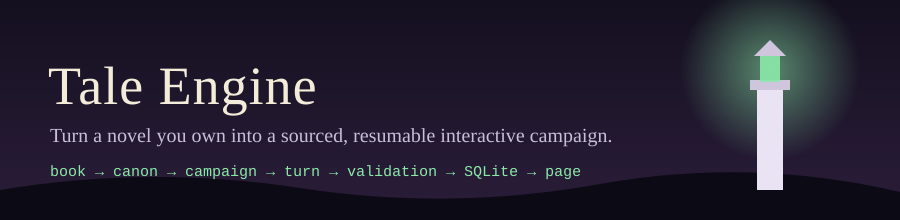
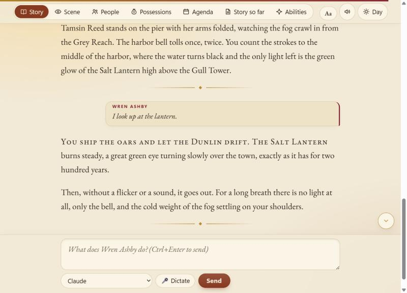
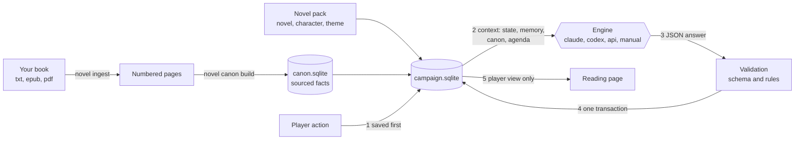

<p align="center"></p>

<p align="center">
  
  
  
  
</p>

**novel-engine reads a novel you own, builds a canon of sourced facts from it, and lets a model narrate your
character's story in that world, while a program keeps the state, the secrets and the world's clock.** The story is saved
in SQLite after every turn, so you can stop, resume and read it back.

<p align="center"></p>

## Features

- **Sourced canon.** Facts extracted from the book, each with the page and a quote that is checked against the text.
  The narrator gets a few relevant facts per turn, never the whole book.
- **Secrets the narrator keeps.** Every fact and event names who may know it (narrator, player, an NPC). The reading page
  shows the player's view only.
- **A world that keeps moving.** Tracked NPCs pursue their goals off screen, deadlines run on a fictional clock, a
  planner summarizes the story and stirs the world.
- **The program keeps the truth.** A model's answer is validated against a schema and the rules, then applied in one
  transaction. Money and possessions are computed, not narrated. An interrupted turn loses nothing.
- **Your save is a file.** SQLite for the canon and for the campaign. Standard library only, no dependency to install.
- **Four engines.** Claude CLI, Codex CLI, the Anthropic API, or **manual** copy and paste with no account at all.
- **A reading page.** Local, no external resource, five themes, icons by category, English and French, your own texts.
- **One folder per novel.** A *novel pack* (`novel.json`, `character.json`, `theme.json`) holds everything that is
  specific to a book; nothing else in the engine knows a novel by name.

## How it works



More in [Architecture](docs/architecture.md).

## Quickstart

Python 3.10 or newer. Nothing else is required.

```bash
pip install .
novel example     # installs "The Salt Lantern", an invented story, and starts its campaign
novel read        # opens the reading page
```

`novel example` needs no account and no model. To play a turn, type an action in the page; with no engine installed,
pick **Manual** and follow the steps in [Engines](docs/engines.md). Run `novel doctor` to see what your machine can use.

### Bring your own novel

```bash
novel init my-novel --title "My Novel" --language en
novel ingest book.epub --novel my-novel            # .txt, .md, .epub, .pdf (pip install ".[pdf]")
novel canon plan my-novel                          # shows the cost, sends nothing
novel canon build my-novel --engine claude --yes   # or codex, api, manual
novel character new my-novel --name Ana --hp 40
novel validate my-novel                            # lists every problem of the pack
novel campaign new my-novel
novel read
```

The canon build is resumable and prints its estimate before sending anything. Edit the pack's JSON files between steps:
see [Novel packs](docs/novel-packs.md), [Character sheets](docs/character-sheets.md) and [Canon](docs/canon.md).

## Configuration

| What | How |
| --- | --- |
| where files go | `novels/`, `campaigns/` in the current folder, or in `$NOVEL_HOME` |
| engine | `--engine claude\|codex\|api\|manual`; by default the saved choice, else the first available |
| API key | `ANTHROPIC_API_KEY` in the environment, never stored |
| the page's language and wording | `language` in `novel.json`, `labels` in `theme.json` |
| the world | `tracked_npcs`, `currency_rates`, `world_rules`, `opening` in `novel.json` |

## Project structure

```
novel_engine/         the package: turn loop, canon, campaign, engines, reader page
  prompts/en/         the narrator's instruction texts, one markdown file each
  assets/             agent rules, JSON contracts, the bundled example novel
  scripts/            what `novel play`, `read`, `resume` and `routine` run
  resources/          bundled icons and fonts, with their licenses
docs/                 the documentation
tests/                the test suite (python -m unittest discover -s tests)
```

Documentation: [index](docs/index.md), [getting started](docs/getting-started.md), [commands](docs/cli.md),
[engines](docs/engines.md), [reader page](docs/reader.md), [prompts and languages](docs/prompts-and-languages.md),
[architecture](docs/architecture.md), [troubleshooting](docs/troubleshooting.md).

## FAQ

**Do I need an account?** No. The manual engine works with any chat tool, and `novel example` needs nothing.

**Which book formats?** `.txt`, `.md`, `.epub`, and `.pdf` with the optional `pypdf`.

**Can I play in another language?** The narration follows `language` in `novel.json`. The page is bundled in English and
French and can be translated key by key; see [Prompts and languages](docs/prompts-and-languages.md).

**What does a canon build cost?** `novel canon plan` prints the tokens it would send, per engine, before anything is
sent. Remote engines refuse to run without `--yes`.

**Is my story private?** Everything stays in files on your machine. Only what a turn needs is sent to the engine you
choose, and only when you choose a remote one.

## Legal note

Use only books you own or that are in the public domain. The book, its extracted text, the work files and `canon.sqlite`
contain material from the book (the canon stores short verbatim quotes). They are ignored by git: **never commit, share
or publish them.** The bundled example novel is an original story written for this project.

## Roadmap

- Let a novel pack enable the vitality mechanics that exist in the engine (charges that refill per night or per
  combat, cooldowns, a day and night schedule).
- Select the language of the narrator's instruction texts, and ship a French set.
- A public-domain novel as a second complete example.
- More engines behind the same transport.

## Contributing

Issues and pull requests are welcome: see [CONTRIBUTING.md](CONTRIBUTING.md). Changes are listed in
[CHANGELOG.md](CHANGELOG.md).

## License and credits

MIT, see [LICENSE](LICENSE). Bundled resources keep their own licenses, listed in
[novel_engine/resources/CREDITS.md](novel_engine/resources/CREDITS.md):

- icons from [game-icons.net](https://game-icons.net) by Lorc, Delapouite and Skoll, CC BY 3.0;
- the fonts Cinzel (Natanael Gama) and EB Garamond (Georg Duffner, Octavio Pardo), SIL Open Font License 1.1.
